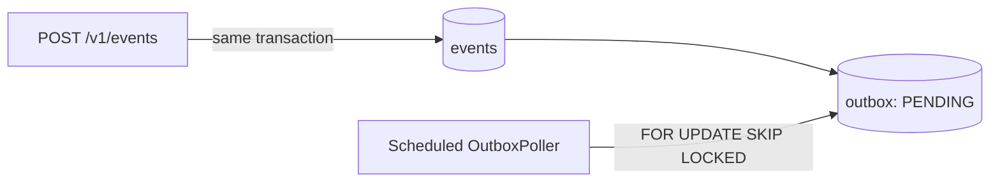

# webhook-delivery

A Java 21 / Spring Boot webhook ingestion service backed by Postgres.

This version intentionally contains the first two project milestones:

1. **Ingestion (`POST` event)** - validates an event and writes the event
   envelope and its `PENDING` outbox row in one database transaction.
2. **Polling / scheduling** - a scheduled worker scans pending outbox rows
   using `FOR UPDATE SKIP LOCKED`, so multiple application instances can
   poll safely without waiting on rows selected by another instance.

HTTP delivery, endpoint registration, retries, signatures, replay, and
dead-letter handling are later milestones and are not part of this stage.

## Architecture



The event body is serialized once and stored in `events.body`. The outbox
contains only durable work metadata and references the event. If the
transaction fails, neither row is committed.

## Quick start

```bash
createdb webhooks
make run
```

### Docker Compose

Docker Compose starts PostgreSQL and the application in the correct order.
Flyway creates the schema automatically when the application starts.

```bash
docker compose up --build
```

In another terminal, publish an event:

```bash
curl -i -X POST http://localhost:8080/v1/events \
  -H 'Content-Type: application/json' \
  -d '{"type":"payment.success","data":{"amount":1999,"currency":"usd"}}'
```

Stop the services with:

```bash
docker compose down
```

To also delete the persisted PostgreSQL volume and start with an empty
database next time:

```bash
docker compose down -v
```

Publish an event:

```bash
curl -X POST localhost:8080/v1/events \
  -H 'Content-Type: application/json' \
  -d '{"type":"payment.success","data":{"amount":1999,"currency":"usd"}}'
```

The API returns `202 Accepted` with the event and outbox identifiers:

```json
{"eventId":"...","outboxId":"..."}
```

The poller runs every second by default. Configure it with:

| Property | Default | Meaning |
|---|---:|---|
| `webhooks.poller-enabled` | `true` | Enable the scheduled outbox worker |
| `webhooks.poll-interval` | `1s` | Delay between polling runs |
| `webhooks.poll-batch-size` | `100` | Maximum pending rows read per run |

## Development

```bash
make test
make build
```

## Next milestones

- Claim and deliver pending events to registered endpoints.
- Add retries, backoff, signatures, and delivery attempt history.
- Add dead-letter and replay APIs.
