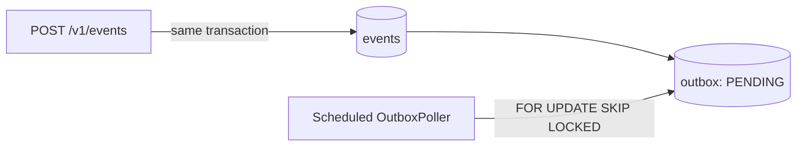

# webhook-delivery

A Java 21 / Spring Boot webhook ingestion service backed by Postgres.

This version intentionally contains the first two project milestones:

1. **Ingestion (`POST` event)** - validates an event and writes the event
   envelope and its `PENDING` outbox row in one database transaction.
2. **Polling / scheduling** - a scheduled worker scans pending outbox rows
   using `FOR UPDATE SKIP LOCKED`, so multiple application instances can
   poll safely without waiting on rows selected by another instance.

HTTP delivery, endpoint registration, retries, signatures, replay, and
dead-letter handling are later milestones and are not part of this stage.

## Architecture



The event body is serialized once and stored in `events.body`. The outbox
contains only durable work metadata and references the event. If the
transaction fails, neither row is committed.

## Quick start with local PostgreSQL

```bash
createdb webhooks
make run
```

The application uses `jdbc:postgresql://localhost:5432/webhooks`,
`postgres`/`postgres` by default. Override these values with `DATABASE_URL`,
`DATABASE_USER`, and `DATABASE_PASSWORD`.

### Docker Compose

Docker Compose starts PostgreSQL and the application in the correct order.
Flyway creates or upgrades the schema automatically when the application
starts. The database is persisted in the `postgres-data` Docker volume.

```bash
docker compose up --build
```

For a completely fresh demonstration database:

```bash
docker compose down -v
docker compose up --build
```

In another terminal, publish an event:

```bash
curl -i -X POST http://localhost:8080/v1/events \
  -H 'Content-Type: application/json' \
  -d '{
    "type": "payment.success",
    "data": {
      "amount": 1999,
      "currency": "usd"
    }
  }'
```

The API returns `202 Accepted` with the event and outbox identifiers:

```bash
{"eventId":"...","outboxId":"..."}
```

Inspect the records created by the request:

```bash
docker compose exec db psql -U postgres -d webhooks
```

Then run:

```sql
SELECT id, type, body, created_at
FROM events
ORDER BY created_at DESC
LIMIT 5;

SELECT id, event_id, status, created_at, updated_at
FROM outbox
ORDER BY created_at DESC
LIMIT 5;
```

The outbox row should have status `PENDING`. The application logs also show
the scheduled poller discovering that row:

```text
Found 1 pending outbox event(s): [...]
```

The current poller only discovers and logs work. It does not send an HTTP
request or change the outbox status yet; claiming, delivery, and status
transitions are later milestones.

Stop the services with:

```bash
docker compose down
```

To delete the persisted PostgreSQL volume as well:

```bash
docker compose down -v
```

## Configuration

The poller runs every second by default:

| Property | Default | Meaning |
|---|---:|---|
| `webhooks.poller-enabled` | `true` | Enable the scheduled outbox worker |
| `webhooks.poll-interval` | `1s` | Delay between polling runs |
| `webhooks.poll-batch-size` | `100` | Maximum pending rows read per run |

## Validation example

Invalid event types and non-object `data` values are rejected with
`400 Bad Request` before anything is written:

```bash
curl -i -X POST http://localhost:8080/v1/events \
  -H 'Content-Type: application/json' \
  -d '{"type":"Invalid Event Type","data":{"amount":100}}'
```

## Development

```bash
make test
make build
```

## Next milestones

- Claim and deliver pending events to registered endpoints.
- Add retries, backoff, signatures, and delivery attempt history.
- Add dead-letter and replay APIs.
